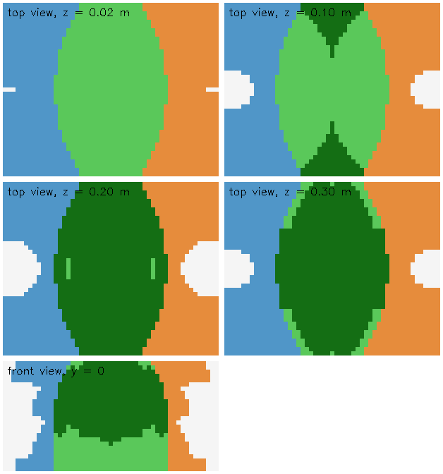

# PROGRESS v5

Tracking from 2026-09-28 (after [`PROGRESS_v4.md`](PROGRESS_v4.md): the independent simulator, honest
tests, the handover toggle). No hardware at hand this round: work in the simulator, and offload batch
work to the Ray cluster at ray.sqrtwo.com.

## Rules (carried over)

- The simulator is its own project; the backend never reads its ground truth (tests use it only to judge).
- Perception is grounded in the cameras only: nothing is inferred from the arms (a closed gripper is not a
  cube, an arm hanging over a track does not keep it alive).

## Plan

1. **Reachability, measured.** Where each follower's tool point can be, per approach direction, by the
   planner's own rules; where the two arms overlap. Computed on the Ray cluster. Answers "is there a
   shared region for a handover?" and replaces hand-picked reach numbers.
2. **Handover in simulation, placed by reachability.** The handover point and the grippers' directions
   come from the overlap map instead of a fixed point midway; verified end to end in the simulator.
3. **Pick and place as a loop: try, observe, try again.** Short actions, each followed by a look; a miss
   or a slip is recovered from (open, back off, look, retry, a bounded number of times) instead of failing
   the whole task. The loop is the backbone; a failure that happens often gets a recovery step of its
   own on top (not limited to a fixed set of steps): a slip in the carry (re-pick from where the cameras
   now see the cube), fingers stalled on the table or a corner (lift a little, look, grasp again), a cube
   nudged while the gripper came down (look again before closing), a placement off target (nudge or
   re-pick it).
4. **Visual-dominant tracking.** A track lives on camera evidence alone. When no camera sees a cube,
   the cameras' depth decides why: something nearer is in the way (occluded: keep it, unconfirmed) or
   they see the table there (gone). Design:
   - Each frame, every track is projected into every camera that should see it. Per camera, the verdict
     is: seen (a detection matches), hidden (depth nearer than the cube there), empty (depth at the table
     or beyond), or out of view.
   - A track is kept while hidden or out of view (flagged, with its age), and dropped as soon as a
     camera sees the table where it was: no memory outlives the evidence.
   - Association uses position and appearance (colour votes over time), with a static prior: a cube on
     the table does not move unless a gripper is at it, so a jump without one needs repeated evidence.
   - Output per cube: seen / hidden / out of view, how long since it was last seen, and by which cameras.
5. **Simulation batches on Ray.** Many simulated runs in parallel (the simulator and the backend, headless),
   to measure success rates of the loop and the tracker instead of judging by single runs.

## Done

- **Reachability, measured** (plan 1). `jobs/reach_map.py` on the Ray cluster (~25 min on 24 CPUs): about
  70,000 poses of one follower (tool point radius x height x 61 approach directions; joint 0 turns it all
  about the base, joint 5 rolls the tool), each solved with ten IK restarts and judged by the planner's
  rules (8 deg joint margin). Stored in `config/reach/wxai_follower.npz` (margin, lowest joint, and the
  joint solution per cell); `myaloha/reach.py` answers "can this arm be here, pointing that way" in W.
  - **On the table, straight down, the arms barely overlap:** left reaches to x = +0.02, right from
    x = -0.02 (bases 0.93 m apart). Tilted, both reach the table over |x| <= 0.2 m.
  - **In the air they overlap widely:** a lens |x| <= 0.26 m about the midpoint, y +-0.4, z up to 0.5 m;
    facing each other (a handover) from about 8 cm up (14,470 points on a 2 cm grid).
     Top views at z = 0.02, 0.10, 0.20, 0.30 m and the front view at
    y = 0 (x across, bases at the left and right edges): blue left only, orange right only, light green
    both, dark green both facing each other.
  - **The planner's IK missed poses that exist:** the solver keeps only the solution nearest its start,
    and six restarts miss some. `_ik` now also starts from the map's solution for the nearest cell
    (joint 0 turned to the bearing, joint 5 to the roll), then from mid-range.
- **Handover placed by reachability** (plan 2). The meeting point is no longer fixed (midway, 20 cm up):
  candidates are the points where the giver can hold the cube out and back off, and the taker come in,
  all with twice the planner's joint margin by the map (cells are coarse: at the edge of the reach a
  pose can be a few degrees tighter), shortest carry first; IK has the last word. In the simulator's
  geometry, 16 of 16 cube/target pairs across the table plan (9 of 16 before, and 1 s each instead of up
  to 15 s); the end-to-end handover test passes.
- **Pick and place loops: try, observe, try again** (plan 3, first part). A try that fails raises
  `Missed` with where the cube must be now; the mod opens, backs off to the staged pose, lets the cameras
  find the cube again there (its colour, detected now, nearest where it must be), re-plans and tries again,
  up to `tries` (default 3). Covered: a missed grasp (at the cube), a drop in the carry (along the path:
  the check above the target sees an empty gripper), a failed handover (at the meeting point), a placement
  more than 1.5 cm off the target (around it). A specialised step for a common miss: in a handover, a
  taker whose fingers close on nothing backs off and comes in once more, the giver still holding. New
  state `recovering`. Test: the cube leaves the gripper mid-carry (lands on the table partway); the mod
  finds it and places it.
- **Tracks live on the cameras' depth** (plan 4, first part). A track no camera detects is asked of every
  camera: one whose depth shows something in front of it keeps it (`unseen: occluded`), one whose depth
  shows the cube there keeps it (`undetected`: its colour was missed), one that sees past where it was
  drops it at once. Only near cameras judge "there" and "gone" (the overhead camera's depth can't tell a
  cube's top from the table); any camera may see a gripper well in front. Output adds `unseen` and
  `seen_ago`.
- **The project on the cluster node** (for simulation batches): `jobs/setup_env.py` puts the code in
  `~/Desktop/IROS26` on the node (Ubuntu 26.04, user neutrino) with everything else inside that folder
  (uv, Python 3.12 and uv's cache in `.uv/`, the backend's and the simulator's environments), and checks
  it: the simulator's tests pass there, and the camera tests pass with the simulator rendering headless
  on the RTX 5090 (MUJOCO_GL=egl). Rerun it after code changes (the environments are kept).
- **Annos "Reach" draws the map:** `/api/reach` returns, per arm, the table region it can pick or place
  straight down (the tool at the grasp height and 4 cm above), traced from the reach map, holes and all.
- **The simulated rig has its own colour profile,** `config/colors/sim.yaml`, calibrated on it with
  `setup/calibrate_colors.py` like any rig (12 known single cubes, 54-100% of each cube's pixels right
  on every camera; with `default`, yellow read 23% on the overhead camera). The test harness uses it;
  run the panel on the simulator with `--colors sim`.
- **The camera relay** (`camrelay/`, its own uv project: numpy and pyrealsense2 only). The only process
  that opens the RealSense cameras: a root launchd daemon (`sudo camrelay/install.sh`, once: a root-owned
  copy in `/usr/local/lib/camrelay`, started at boot, restarted if it stops) serving them on
  `127.0.0.1:8820` over the simulator's protocol, each frame stamped with when the camera delivered it.
  It follows the cameras: one plugged in is opened and served, one unplugged (or whose frames stop) is
  dropped and opened again when it is back; nobody types a password. It also keeps 192.168.10.200 on
  en14. The backend reads cameras only by address (`--cameras`, default the relay; `--simulator` for
  the simulator's), asks again every 2 s for a camera that is down, and never needs root: the sudo
  relaunch and the USB code are gone from it. Real rig and simulator now look the same to the backend
  for cameras; the arms were already the same driver interface (the real driver over the network, or
  the simulator's stand-in). Tests: the relay against a fake USB source (plug, unplug, replug, a
  wedged camera, one that won't open); the backend's resume against the simulator. Not yet tried with
  the real cameras (the robot is away).
- **The simulator's physics is MuJoCo's** (it only drew before; cube motion was scripted rules). The
  cubes are free rigid bodies: gravity, friction, contacts with the table, each other, the fingers and
  every arm link (collision meshes as convex hulls; each arm ignores itself, the two arms collide).
  The followers' joints are position servos (links gravity-compensated; the world still adds its
  zero offsets and sag to the targets); the carriages are force-limited servos, so fingers closing on
  a cube stop on it (their reading is where they are) and hold it by friction, squeezing by how far
  their target is past it. A thread steps it with the clock (2 ms steps, ~16x faster than real time);
  `World(realtime=False).step(s)` for tests. Contacts are stiff (a 10 g cube squeezed by two servos
  let the fingers sink ~7 mm with MuJoCo's defaults). The truth adds `tilt`, and `held_by` is an arm
  whose two pads both touch the cube. Tests: a dropped cube rests on another; one overhanging its
  support by 19 mm (its centre past the edge) topples onto the table; one 6 mm off stays; fingers stop
  on a cube's faces (24.8 mm), lift it and drop it when they open; closed fingers sweeping through a
  cube push it. The backend's end-to-end tests pass unchanged (pick and place, handover, drop recovery).
- **Jobs on the cluster:** `uv run python jobs/ray_job.py NAME OUT` uploads jobs/NAME.py with only the
  repo files it lists, runs it, and saves what it prints between RESULT_BEGIN and RESULT_END.
- **Ray cluster access.** ray.sqrtwo.com serves the Ray dashboard and Jobs API over HTTPS only (the Ray
  client port is closed): work goes up as jobs, `uvx --python 3.12 --from "ray[default]==2.58.0" ray job
  submit --address https://ray.sqrtwo.com --working-dir DIR -- python SCRIPT`. One node: 24 CPUs, an
  RTX 5090, 23 GB; Python 3.14 and NumPy there, no MuJoCo (a job can install it).
- **From the rig (2026-09-27/28, the last hardware session):**
  - The grasp: `close_on_object` switched the gripper to external-effort mode after contact, and the
    fingers sprang back open, gripping nothing (a 25 mm cube "read 28.6 mm"). It now holds in position
    mode, aimed 4 mm per finger inside where the fingers stopped: the fingers squeeze to 23.4 mm.
  - Fingertips go to 8 mm above the cube's bottom (they went to its mid-height; only the tapered tips
    pinched its top edge).
  - Every grasp is checked by the gripper reading and the wrist camera (the cube's colour at the fingertips'
    depth), after the lift and above the target; the placement by the cameras after the arm has left.
  - The cube detector no longer invents a cube in a gripper whose fingers stopped apart, nor keeps a track
    alive under a gripper.
  - Travel height follows the columns the cameras see near the path (4.5 cm on a clear table), and the
    fixed 0.40 m reach gate is gone (IK decides): a pick 0.47 m and a place 0.43 m from the right base
    worked, 2.1 mm from the target.
  - Colour profiles (`config/colors/`, `panel --colors NAME`, `setup/calibrate_colors.py`); `expo` for the
    white expo table.

- **Tracking a cube in a gripper** (it was 12-20 mm off while carried, with 7 track ids in one pick,
  phantom stacks under it and red/orange flips). Reproduced on an isolated simulated rig (own simulator
  and backend on free ports, calibrated by localize; the simulator's truth only judges), then fixed:
  - Heights are continuous: a cube within 8 mm of a level's height rests there, else it is in the air
    (no level; no hidden cubes assumed under it). A cube read at level n >= 1 is in the air when its own
    camera, or a table-level probe, sees past where the cube under it would be.
  - A top face is told from a side by the spread of its points in xy (not by their height), so a cube in
    the air no longer falls back to "side face, pushed half a cube away".
  - Every camera contributes: moving wrists too (their pose interpolated to the frame's capture time
    between the joint readings around it), the low camera reports cubes in the air, and a far view is
    placed at the height of the cube in the air above it. A side probe that finds something with no cube
    colour (a finger) can't raise a column.
  - Each wrist camera's own fingers are masked (no colour, no depth): their pixels follow from the URDF
    carriage joints, the hand-eye pose and the aperture (`myaloha/gripper.py`, meshes projected, cached
    per aperture); checked on simulated and real wrist frames.
  - The tracker is a constant-velocity Kalman filter per cube (x, y, z and rates), associated in 3-D
    after predicting to the frame's time; it reports the velocity and the state's time `t`. Depth evidence
    keeps only confirmed tracks, and counts a surface as "the cube there" only within half a cube of it.
  - Result (5 cm/s carry): 2.9 mm mean error extrapolated to the query time with the reported velocity
    (12.8 mm max), 8.8 mm without; lifting 4.9 mm mean; no phantom cubes. The report is ~300 ms old at
    3 Hz. One id change remains: lifted through a level's height with nothing seeing under it, a cube
    reads as a two-stack for a frame.

## Open

- Simulation batches on Ray (plan 5): the environment is ready on the node; next, a job that runs many
  simulated pick-and-place tasks in parallel and reports success rates and failure kinds.
- Tracking, still to do: the id change when a lifted cube passes a level's height (continuity over
  time should win over a one-frame "two-stack"); appearance for association (beyond colour votes); the
  latency (3 Hz, ~300 ms); the low camera registration failing on the simulated rig's latest localize.
  Research on sparse-view object registration: `_survey/sparseview_recon/`.
- More specialised recovery steps as failures show up (a stalled grasp: lift a little and grasp again;
  a nudge for a placement slightly off).
